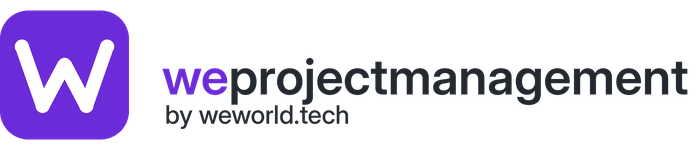

# WeProjectManagement

**Solution complète de gestion de projets, de programmes et de portefeuilles**, éditée par [WeWorld Tech](https://weworld.tech) : planification agile, lots de travaux, feuilles de route, Gantt, suivi du temps, budgets, réunions, documents, wiki, tableaux, calendriers, intégrations — et une couche de **Pilotage** best-in-class (cockpit, PMO 360, registres, revues de jalon, reporting cadencé, demandes de projet, organisation 360, gouvernance, rapports).

WeProjectManagement est un **dérivé de [OpenProject](https://www.openproject.org)** (© OpenProject GmbH, et avant lui ChiliProject et Redmine), publié sous **GNU GPL v3**. Le code OpenProject est intégralement conservé ; WeProjectManagement y ajoute une identité, une méthode de pilotage et un module dédié. Voir [docs/weprojectmanagement/LICENCE-ET-MARQUES.md](docs/weprojectmanagement/LICENCE-ET-MARQUES.md).

## Ce que WeProjectManagement ajoute

| Couche | Contenu |
|---|---|
| **Identité weworld** | Logo et icônes WeProjectManagement, thème violet (clair / sombre), trois thèmes prêts à l'emploi, modèles de courriels et d'exports PDF aux couleurs de la marque, nom produit dans l'interface (FR, EN). |
| **Pilotage › Cockpit** | Situation du portefeuille, météo des quatre signaux (délais, budget, risques, reporting), projets critiques et faux verts, horizon glissant des jalons, arbitrages, « Mon espace », indicateurs du dispositif. |
| **Pilotage › PMO 360** | Portefeuille consolidé avec filtres et regroupements, santé déclarée vs calculée, export CSV ; master plan SVG sur une échelle commune avec écart de fin ; plan de charge mensuel par personne ; conformité du reporting et relances. |
| **Pilotage › Projet** | Fiche de pilotage (classe A/B/C automatique, catégorie, axe, acteurs, budget, dates, référence), cockpit projet, neuf registres (risques, problèmes, décisions, actions, changements, livrables, bénéfices, parties prenantes, impacts) avec export / import CSV, revues de jalon P0–P8 avec Go / No-Go, rapports d'avancement soumis et validés par le PMO, flash report imprimable. |
| **Pilotage › Portefeuille** | Demandes de projet (éligibilité, qualification, décision en Tour de contrôle, conversion en projet P0), organisation 360 (entités, responsables, effectifs, budgets, projets pilotés et impactés), gouvernance (instances en cascade, séances, agenda mensuel, relevé de décisions), dossier Tour de contrôle (9 pages) et rapport exécutif prêts pour PDF, référentiel de la méthode. |
| **Administration** | Paramètres du pilotage (devise, unité, seuils, classes, cadences, catégories, axes, libellés de jalons par catégorie), tâches `rake pilotage:*`. |

Le module Pilotage est un plugin standard (`modules/pilotage`) : il suit les conventions OpenProject (engine, permissions, menus, ViewComponent + Primer, Hotwire) et ne modifie pas le cœur.

## Fonctionnalités premium

Les add-ons Enterprise d'OpenProject GmbH restent activables avec un jeton officiel (Administration › Édition Enterprise). La couche premium propre à WeProjectManagement est le module **Pilotage**, développé par WeWorld Tech et livré sans jeton.

## Démarrer

- **Production (Docker)** : [deploy/README.md](deploy/README.md).
- **Développement** : identique à OpenProject — Ruby 4.0.7, Node 24, PostgreSQL 16+, puis `bundle install`, `cd frontend && npm ci`, `bundle exec rails db:migrate`, `bin/dev`. Voir [docs/development](docs/development/).
- **Après installation** : `bundle exec rake pilotage:seed_governance` (instances), `rake pilotage:enable_all` (fiches et jalons sur les projets existants), `rake pilotage:demo` (données fictives, instances de démonstration seulement).

## Documentation

- [Module Pilotage — guide fonctionnel](docs/weprojectmanagement/PILOTAGE.md)
- [Licence, marques et jeton Enterprise](docs/weprojectmanagement/LICENCE-ET-MARQUES.md)
- [Journal des modifications WeProjectManagement](docs/weprojectmanagement/CHANGELOG.md)
- Documentation OpenProject (valable pour tout le socle) : https://www.openproject.org/docs/ — ancien README : [README.openproject.md](README.openproject.md)

## Licence

GNU General Public License v3 — voir [LICENSE](LICENSE) et [COPYRIGHT](COPYRIGHT). OpenProject est une marque d'OpenProject GmbH ; WeProjectManagement et weworld sont des marques de WeWorld Tech.
